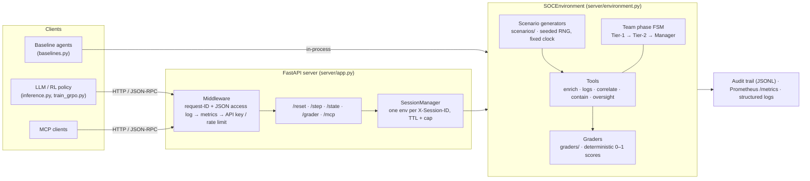
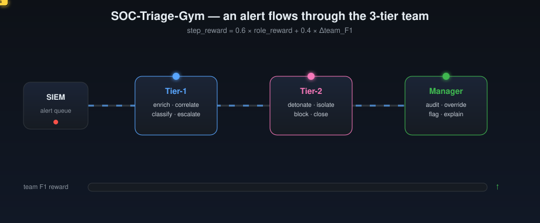

# SOC-Triage-Gym v3

[](https://colab.research.google.com/github/ROHITCRAFTSYT/SOC-Triage-Gym/blob/main/soc_triage_gym_v2_training.ipynb)
[](https://huggingface.co/spaces/rohitcraftsyt/openenv2)
[](https://huggingface.co/rohitcraftsyt/soc-grpo-tier1)
[](.github/workflows/ci.yml)
[](pyproject.toml)
[](LICENSE)

An OpenEnv reinforcement-learning environment that trains and evaluates AI agents as a coordinated SOC team, not a single analyst, across **10 tasks** spanning single-alert triage up to a **250-step APT campaign**, with mid-episode schema drift, rotating expert judges, token-length-scaled rewards, and three external NPC actors feeding into the inbox. Training uses **RLVR** (verifiable programmatic graders) inside an **RLVE** loop (adaptive Red-Team Generator).

A real Security Operations Center has three tiers: Tier-1 triages alerts and escalates, Tier-2 contains confirmed threats, and a Manager audits the team's decisions. SOC-Triage-Gym models all three roles with a live ticket bus, a phase state machine, and an LLM-based manager judge. The reward signal is a blend of individual role performance and team F1, so an agent that maximizes personal score at the expense of team outcome is penalized.

> **Quick tour:** `bash scripts/quickstart.sh` installs dependencies, starts the environment, and runs a guided walkthrough in about a minute. See [Quick Start](#quick-start) for the manual path.

---

## Architecture



Every request goes through the middleware stack, picks up its session's isolated environment, and is answered from in-memory scenario state (no disk I/O inside an episode). Same `(task_id, seed, actions)` gives the same observations and rewards. That guarantee is enforced by [`tests/test_trajectory_determinism.py`](tests/test_trajectory_determinism.py) and by the benchmark's repeat check in CI.

<details><summary>Original v2 architecture poster</summary>


</details>

**Reward blend per step:**
```
step_reward = 0.6 × role_specific_reward + 0.4 × Δteam_F1
```

Team F1 uses delta (not sticky value) — NOOP-spamming after a correct classification yields zero team reward. See the **Reward Integrity** section below for the six exploit vectors this defends against.

---

## Tasks

| Task | Mode | Alerts | Max steps | Difficulty |
|------|------|--------|-----------|-----------|
| `phishing` | solo | 1 | 15 | easy |
| `ransomware` | solo | 1 | 15 | easy |
| `cloud_compromise` | solo | 1 | 15 | medium |
| `lateral_movement` | solo | 5 | 30 | medium |
| `queue_management` | solo | 20 | 60 | hard |
| `insider_threat` | solo | 30 | 80 | expert |
| `team_phishing_escalation` | team | 1 | 68 | easy |
| `team_lateral_team` | team | 8 | 68 | medium |
| `apt_campaign` | solo | 60+ | **250** | super-hard |
| `red_team_generated` | team | dynamic | 30–250 | adaptive |

> **Scoring note for `red_team_generated`:** reward here is the *red-team* reward — the inverse of blue-team performance, plus a novelty bonus when blue lands in the trainable sweet spot `[0.35, 0.65]`. A low score means the blue oracle beat the generated scenario; a high score means the generator outsmarted the defender. See [graders/red_team_grader.py](graders/red_team_grader.py).

The tasks span three orders of magnitude in episode horizon and two in queue size — a single agent has to scale from a one-alert triage to a 250-step campaign:


*Regenerate with `make plots` (`scripts/gen_readme_assets.py`) — every value is read from committed task metadata.*

**MITRE ATT&CK catalog.** The techniques the graders recognize live in [`data/mitre_attack.py`](data/mitre_attack.py). Browse them from the CLI — `soc-gym techniques` (add `--tactic execution` to filter, `--json` for machine-readable output). The module also exposes hierarchy helpers `get_parent_technique` / `get_sub_techniques` and the punctuation-tolerant `normalize_technique_id` used by grading, all re-exported from the `data` package.

---

## Team Mode



*A ticket travels Tier-1 → Tier-2 → Manager while the team-F1 reward meter fills. Animated SVG — no binary, renders inline on GitHub and the HF Space.*

Team episodes run through three phases. Each phase has a dedicated step budget.

**Tier-1 actions:** `enrich_indicator`, `query_logs`, `correlate_alerts`, `check_asset`, `check_user`, `classify_alert`, `map_technique`, `recommend_action`, `escalate_to_tier2`, `phase_complete`, `noop`

**Tier-2 actions:** `forensic_timeline`, `sandbox_detonate`, `memory_analysis`, `isolate_host`, `disable_user`, `block_ioc`, `close_case`, `phase_complete`, `noop`

**Manager actions:** `review_decision`, `override_classification`, `flag_inconsistency`, `explain_team_behavior`, `phase_complete`, `noop`

Inter-role communication flows through the ticket bus (`POST /step` with `escalate_to_tier2` creates a ticket; `GET /inbox/{role}` retrieves it).

---

## Reward Integrity

A reward function is only as good as the exploits it can't be farmed by. Six exploit vectors were found, fixed, and locked down by regression tests in [tests/test_team_mode.py](tests/test_team_mode.py).


| # | Vector | Test | Fix |
|---|---|---|---|
| 1 | NOOP team_F1 farming | `test_team_f1_delta_not_sticky` | team_F1 reward is delta-based; consumed once on classification |
| 2 | Duplicate `close_case` | `test_close_case_idempotency` | Repeat close on same alert is now penalized |
| 3 | Over-escalation flooding | `test_over_escalation_penalty` | >25% escalation rate triggers a per-step role penalty |
| 4 | Phase-complete short-circuit | `test_tier1_phase_complete_with_zero_escalations_short_circuits` | Empty `phase_complete` ends episode with zero score |
| 5 | Spurious manager flags | `test_manager_flag_inconsistency_spurious_penalty` | Flagging consistent decisions is now penalized |
| 6 | Judge-fallback bypass | `test_manager_judge_fallback_on_missing_api_key` | Heuristic fallback bounded to (0.001, 0.999), API-free |

Reproduce with `python scripts/reward_integrity_audit.py`.

**Scenario integrity.** Rewards are only trustworthy if the *scenario* they're
graded against is well-formed. A generated `ScenarioConfig` whose answer key
points at alert IDs that don't exist — or puts one alert in two of the
true/false/benign partitions — silently corrupts every reward derived from it.
`scenarios/validate.py` (`validate_scenario` / `assert_valid`) checks these
invariants; run it across every registered scenario and seed with:

```bash
make check-scenarios      # or: python cli.py check-scenarios
```

---

## Red-Team Curriculum

The Red-Team Generator co-evolves with the blue team. After each curriculum round:

- blue win rate > 75% → difficulty_floor increases by 0.1
- blue win rate < 45% → difficulty_floor decreases by 0.1
- otherwise → difficulty holds

This keeps the agent in the learning zone automatically.


*Blue-team win rate oscillates around 0.5 as the Red-Team Generator adapts difficulty. The generator converges to an equilibrium that matches blue-team skill level — the hallmark of a self-improving curriculum.*

---

## GRPO Training

> Also runnable on Kaggle (free T4, 30h/week). Clone the repo and run `python scripts/train_and_evaluate.py` — override `SOC_TRAIN_TASKS`, `SOC_TRAIN_N_SEEDS`, `NUM_EPOCHS`, `NUM_GENERATIONS` env vars to fit the free tier budget.

Training uses real per-step GRPO — not full-episode oracle rollouts.

```
Dataset row = (observation at step_index, task_id, seed, step_index)
Reward      = env.step(model_action).reward   ← immediate step signal
```

The reward function replays the environment to `step_index` deterministically (same seed → same state), applies the model's single action, and returns the env's immediate blended step reward.

```bash
# Colab/GPU training — recommended production recipe (v0.3):
# staged curriculum + parallel reward scoring + held-out eval + run tracking
python train_grpo.py --role tier1 --model Qwen/Qwen2.5-0.5B --unsloth     --curriculum --parallel-rewards 4 --eval-episodes 5

# Dry-run (oracle baseline, no GPU)
python train_grpo.py --role tier1 --dry-run

# Same via the CLI, plus run inspection
soc-gym train --role tier1 --curriculum --parallel-rewards 4
soc-gym runs
```

### v0.3 training toolkit ([`training/`](training/), guide: [docs/TRAINING.md](docs/TRAINING.md))

| Enhancement | What it does |
|---|---|
| **Staged curriculum** (`--curriculum`) | Easy → hard task ladder with reward promotion gates; the final stage mixes in adaptive `red_team_generated` scenarios, closing the RLVE loop |
| **Parallel reward scoring** (`--parallel-rewards N`) | Scores each GRPO completion group concurrently across N isolated server sessions — reward evaluation is the wall-clock bottleneck, so this is a near-linear speedup |
| **Structured run storage** (`runs/<run_id>/`) | Every run records config + git provenance, an append-only `metrics.jsonl` stream, rotated checkpoints, eval reports, and an auto-generated `MODEL_CARD.md` |
| **Held-out eval + best tracking** (`--eval-episodes N`) | Evaluates the trained model on disjoint seeds (100+) after training and tracks the best checkpoint |
| **Early stopping** (`--early-stop-patience N`) | Stops when the training reward plateaus instead of burning the GPU budget |
| **Better trainer defaults** | Cosine LR schedule with warmup, gradient clipping, `save_total_limit` rotation, automatic bf16 on supported GPUs |

All flags are opt-in; the original single-shot training path is unchanged.
See [`soc_triage_gym_v2_training.ipynb`](soc_triage_gym_v2_training.ipynb) for the full Colab walkthrough.

---

## Quick Start

**1. Install and check it works (no GPU, no API key):**

```bash
pip install -e ".[dev]"
make test              # ~420 tests, ~5 s
make benchmark         # baseline leaderboard + determinism check, ~2 s
```

**2. Use the environment in-process (Python API):**

```python
from models import SOCAction
from server.environment import SOCEnvironment

env = SOCEnvironment()
obs = env.reset("phishing", seed=42)                    # same seed -> same episode
alert = obs.alert_queue[0]
obs = env.step(SOCAction(action_type="query_logs", log_source="email_gateway",
                         query_alert_id=alert.alert_id))
obs = env.step(SOCAction(action_type="classify_alert", alert_id=alert.alert_id,
                         classification="true_positive", confidence=0.9))
obs = env.step(SOCAction(action_type="submit_investigation"))
print(obs.task_score, env.grade_with_breakdown()[1])
```

**3. Run the server in Docker (non-root, JSON logs, healthcheck):**

```bash
docker compose up -d
curl -s localhost:7860/health
```

**4. Or run it directly:**

```bash

# Guided demo: starts the server and walks through a full episode:
python demo.py

# Presenter-paced five-act demo (Enter to advance):
python demo_live.py          # --auto to rehearse · --train for the no-GPU dry-run

# Or start the server and drive it manually:
uvicorn server.app:app --host 0.0.0.0 --port 7860
```

**Solo episode:**
```bash
curl -X POST http://localhost:7860/reset \
  -H "Content-Type: application/json" \
  -d '{"task_id":"phishing","seed":42}'
```

**Team episode:**
```bash
curl -X POST http://localhost:7860/reset \
  -H "Content-Type: application/json" \
  -d '{"task_id":"team_lateral_team","seed":42,"mode":"team"}'
```

**Scripted oracle baseline:**
```bash
python inference.py
```

**Publish a trained adapter to the HuggingFace Hub:**
```bash
export HF_TOKEN=hf_xxx       # write scope
python scripts/hf_publish.py --adapter ./soc_grpo_tier1 --repo USER/soc-triage-tier1
# also sync the Space:
python scripts/hf_publish.py --space
```

The script autogenerates a model card from `training_summary.json` (training config, results, env links). See [scripts/hf_publish.py](scripts/hf_publish.py) for options.

---

## Leaderboard

Reference policies on every task: mean ± std task score over 5 seeds. Produced by [`benchmark.py`](benchmark.py) and committed in [`benchmarks/results.md`](benchmarks/results.md). CI fails if this table no longer matches the code.

| Task | `submit` | `random` | `heuristic` | `oracle` |
|---|---:|---:|---:|---:|
| `phishing` | 0.001 ± 0.000 | 0.116 ± 0.083 | 0.673 ± 0.267 | 0.880 ± 0.098 |
| `ransomware` | 0.001 ± 0.000 | 0.198 ± 0.261 | 0.760 ± 0.196 | 0.880 ± 0.098 |
| `cloud_compromise` | 0.001 ± 0.000 | 0.238 ± 0.314 | 0.705 ± 0.159 | 0.940 ± 0.049 |
| `lateral_movement` | 0.001 ± 0.000 | 0.051 ± 0.065 | 0.710 ± 0.000 | 0.750 ± 0.000 |
| `queue_management` | 0.001 ± 0.000 | 0.027 ± 0.038 | 0.885 ± 0.000 | 0.920 ± 0.004 |
| `insider_threat` | 0.001 ± 0.000 | 0.032 ± 0.035 | 0.782 ± 0.000 | 0.897 ± 0.006 |
| `apt_campaign` | 0.001 ± 0.000 | 0.002 ± 0.002 | 0.640 ± 0.005 | 0.800 ± 0.000 |
| `team_phishing_escalation` | 0.001 ± 0.000 | 0.001 ± 0.000 | 0.999 ± 0.000 | n/a |
| `team_lateral_team` | 0.001 ± 0.000 | 0.001 ± 0.000 | 0.800 ± 0.000 | n/a |
| **Mean over tasks** | **0.001** | **0.074** | **0.773** | **0.867** |

Task score in [0.001, 0.999], mean ± population std over seeds 42, 123, 256, 789, 1024. Determinism: PASS (2 repeats per cell).

| Agent | What it is |
|---|---|
| `submit` | Submits immediately. The zero-effort floor; must score ~0 or the grader is paying for inaction. |
| `random` | Uniform over role-valid actions with parameters drawn from the observation (seeded). |
| `heuristic` | Observation-only rules: [`baseline_agent.py`](baseline_agent.py) solo, `train_grpo.oracle_action` in team mode. |
| `oracle` | **Privileged**: reads ground truth and plays the grader checklist within 75% of the step budget. It is a reference ceiling, not a competitor, and is solo-only. |

To add your agent, implement `reset(task_id, seed, mode, config)` and `act(obs) -> action dict` (see [`baselines.py`](baselines.py)), register it in `AGENTS`, and run `python benchmark.py --agents yours,heuristic,oracle`.

---

## Training results

These charts and numbers come from the first GRPO run, **before** the reward, feedback and prompt fixes listed in the [CHANGELOG](CHANGELOG.md). They document that run; they are not current baselines. Current reference scores are in the [Leaderboard](#leaderboard).

### Oracle reward curve

Running `python train_grpo.py --role tier1 --dry-run` produces the per-episode oracle reward curve across all tier-1 tasks and seeds:


Oracle mean across 20 episodes (phishing, team_phishing_escalation, team_lateral_team) = **0.90**.

### Baseline gap — random vs oracle

`python train_grpo.py --compare --role tier1` bounds the problem on both sides: a uniform-random policy is the floor an untrained LLM competes against; the scripted oracle is the ceiling a trained LLM should approach. The gap between the two lines is the headroom GRPO has to close.


| Policy | Mean task score | Notes |
| --- | --- | --- |
| Random (untrained floor) | **0.063** | uniform over role-valid action types |
| Oracle (scripted ceiling) | **0.900** | heuristic defined in `train_grpo.py:oracle_action` |
| **Learnable gap (Δ)** | **+0.836** | headroom for an RL-trained policy |

Raw per-episode numbers are committed at `reward_comparison_baseline_tier1.csv`.

### GRPO training run — loss curve + held-out eval

A **minimal** GRPO run on Kaggle T4 (1 epoch × 15 seeds × 1 task × group=4 → 27 optimizer steps). Trained adapter is published at [**huggingface.co/rohitcraftsyt/soc-grpo-tier1**](https://huggingface.co/rohitcraftsyt/soc-grpo-tier1) — reloadable with `FastLanguageModel.from_pretrained("rohitcraftsyt/soc-grpo-tier1")`.


| Metric | Value |
| --- | --- |
| Oracle avg (ceiling) | **0.999** |
| Trained avg | **0.001** |
| Δ | **-0.998** |
| Training steps | 27 |
| Eval seeds | 100-114 (15 held-out) |

**What this result means.** 0.001 is the score floor, on every held-out episode: the adapter never got a team episode past triage. Re-running the eval loop with scripted text policies showed that five different behaviours (prose instead of JSON, constant `noop`, constant `phase_complete`, a bare keyword, and even correct classification without escalation) all land on exactly 0.001, so the number alone can't distinguish underfitting from a degenerate policy. Three environment bugs that each produce exactly this score were found and fixed afterwards: ending triage with no work paid +0.001 per step, the feedback told Tier-1 to `submit_investigation`, and Tier-1 was allowed to submit at all. The training prompt was also rewritten so the policy can see its own progress. This adapter predates all of that. The next run's eval writes every completion to `eval_trace.jsonl`, so its score can be explained rather than guessed at.

### Reproducing the trained-model curve

The training loop is packaged as a one-click Colab notebook — [**`soc_triage_gym_v2_training.ipynb`**](soc_triage_gym_v2_training.ipynb) ([open in Colab](https://colab.research.google.com/github/ROHITCRAFTSYT/SOC-Triage-Gym/blob/main/soc_triage_gym_v2_training.ipynb)) — so the stack never needs to be rebuilt by hand:

| Step | Cell | What happens | Wall time on T4 |
| --- | --- | --- | --- |
| 1 | *Install* | `unsloth`, `trl`, `peft` + repo clone | ~4 min |
| 2 | *Server* | Uvicorn on port 7860 | ~5 s |
| 3-4 | *Verify + baseline* | oracle rollouts, prints avg score | ~30 s |
| **4b** | ***Random-vs-oracle gap*** | **emits the gap plot above; runs without a GPU** | ~1 min |
| 5-7 | *Load model + dataset + reward fn* | Unsloth 4-bit QLoRA on Qwen2.5-0.5B; per-step dataset | ~3 min |
| 8 | *GRPO train* | 3 epochs, group=8, per-step reward against the live env | **~70-90 min** |
| 9 | *Save* | merged-16bit + LoRA to `./soc_grpo_tier1*` and Google Drive | ~1 min |
| 10-11 | *Eval + plot* | trained-model curve + red-team curriculum oscillation — emits `soc_grpo_results.png`, `redteam_curriculum.png` | ~5 min |

The notebook is designed so **cells 1-7 run on free-tier Colab in ~8 minutes and surface the gap plot without consuming GPU compute** — enough to verify the pipeline works without running the 70-minute GRPO cell.

---

## API

| Endpoint | Method | Purpose |
|----------|--------|---------|
| `/health` | GET | Liveness check |
| `/tasks` | GET | All 10 tasks |
| `/reset` | POST | Start episode |
| `/step` | POST | Submit action |
| `/state` | GET | Current state |
| `/grader` | POST | Score current state |
| `/baseline` | POST | Run oracle baseline |
| `/generate_scenario` | POST | Generate adversarial scenario |
| `/inbox/{role}` | GET | Ticket inbox for tier1/tier2/manager |
| `/actors/messages` | GET | External NPC actor inbox |
| `/policy/current` · `/policy/history` | GET | Active policy version & drift history |
| `/reward/config` · `/reward/token_bonus` | GET/POST | Token-scaled reward preview |
| `/experts/current` · `/experts/rotate` · `/experts/panel` | GET/POST | Rotating expert judge |
| `/tickets` · `/tickets/open` · `/tickets/{id}/resolve` · `/tickets/can_disable_user` | GET/POST | Enterprise ticketing + cross-app rule |
| `/metrics` | GET | Prometheus operational metrics |
| `/episodes` · `/episodes/{id}/trace` | GET | Episode audit trail + JSONL replay export |
| `/sessions` | GET/DELETE | Live session pool (multi-tenant admin) |
| `/themes/coverage` | GET | Machine-readable manifest of features and reward-hacking defenses |

---

## Reward Design

Dense step rewards for productive investigation. Final score on submit/phase_complete is the grader score (0–1) × efficiency multiplier.

**Per-action rewards (examples):**

| Action | Reward |
|--------|--------|
| Correct indicator enrichment | +0.08 |
| Correct classification | +0.15 |
| Escalate true positive | +0.10 |
| Escalate false positive | −0.05 |
| Over-escalation (>25% of alerts) | −0.08 |
| Host isolation (TP) | +0.20 |
| Host isolation (FP) | −0.15 |
| Legitimate flag_inconsistency | +0.15 |
| Spurious flag_inconsistency | −0.15 |
| Duplicate close_case | −0.02 |

**Efficiency multiplier:**

| Budget used | Multiplier |
|-------------|------------|
| ≤ 50% | ×1.00 |
| ≤ 75% | ×1.00 |
| ≤ 90% | ×0.85 |
| > 90% | ×0.70 |


*Solve early and keep the full reward; drag the investigation past 90% of the step budget and the final score is taxed to ×0.70. Sourced from [`server/environment.py`](server/environment.py) `_efficiency_multiplier()`.*

---

## Test Coverage

```
460 passed, 1 skipped    # pytest -q --cov=.  (66% line coverage, tests excluded)
```

New in this release: [`test_rewards.py`](tests/test_rewards.py) (score bounds, inaction earns nothing, heuristic > random, oracle ≥ heuristic, loop-penalty and anti-guessing behaviour), [`test_trajectory_determinism.py`](tests/test_trajectory_determinism.py) (byte-identical rollouts in solo and team mode), [`test_registry_consistency.py`](tests/test_registry_consistency.py) (every advertised task has a grader and is fully scorable), [`test_api_validation.py`](tests/test_api_validation.py), [`test_logging.py`](tests/test_logging.py), and [`test_benchmark.py`](tests/test_benchmark.py) (committed leaderboard is fresh).

Earlier coverage:

Coverage includes: solo backward-compat, team phase state machine, ticket bus, containment tools, manager oversight, team grader, red-team generator, reward-hack regression tests (close_case idempotency, team_f1 delta, zero-escalation guard, over-escalation threshold, manager judge fallback), **plus feature tests**: multi-actor determinism & role routing, policy-drift schedule & active-at semantics, token-bonus floor/cap/monotonicity, expert-panel rotation & weight shift, ticketing cross-app rule, apt_campaign narrative reward growth, and **cross-scenario generation determinism** (every registered scenario is byte-identical for a fixed seed and seed-sensitive — the guarantee the whole "same seed → same state" replay rests on).

---

## Repository Layout

```
soc-triage-gym/
  server/           FastAPI app + SOCEnvironment + sessions/security/metrics/audit modules
  scenarios/        Scenario configs + RedTeamGenerator + PolicyDriftEngine + apt_campaign
  graders/          Task graders + ManagerJudge + ExpertPanel + token-scaled reward + apt_campaign grader
  tools/            enrichment, log query, correlation, containment, oversight, ticketing (SLA)
  actors/           External NPC actors: ThreatIntelFeed, ComplianceOfficer, EndUserReporter
  tests/            ~460 tests (rewards, determinism, prompts, API validation, team mode, production, training)
  scripts/          gen_plots.py (reward curves), replay.py (deterministic CLI)
  training/         v0.3 training toolkit: curriculum, parallel rewards, run manager, eval
  models.py         Pydantic v2 types (incl. ActorMessage, PolicyVersion, RewardBlendConfig, ExpertProfile, TicketSLA)
  train_grpo.py     Per-step GRPO training script (Unsloth merged-16bit save path)
  inference.py      Scripted oracle baseline
  benchmark.py      Baseline leaderboard + determinism check across all 9 tasks
  baselines.py      submit / random / heuristic / oracle agents + in-process runner
  demo.py           One-command guided demo
  demo_live.py      Presenter-paced five-act live demo (see DEMO_RUNBOOK.md)
  cli.py            soc-gym CLI (serve · demo · benchmark · tasks · techniques · validate · check-scenarios)
  client.py         Python SDK (retries, sessions, auth, run_episode driver)
  docker-compose.yml Production deploy (non-root, read-only FS, audit volume)
  docs/PRODUCTION.md Production deployment & operations guide
  site/             Self-contained presentation website (index.html + classic.html)
  openenv.yaml      OpenEnv metadata
```

---

## RLVR / RLVE Mapping

| Concept | Where it lives |
|---|---|
| **RLVR** — verifiable rewards from programmatic checks | [`graders/`](graders/) — 8 per-task graders + [`graders/token_scaled_reward.py`](graders/token_scaled_reward.py) + [`graders/expert_panel.py`](graders/expert_panel.py) |
| **RLVE** — adaptive verifiable *environment* (difficulty tracks policy) | [`scenarios/red_team_generator.py`](scenarios/red_team_generator.py) |
| **Step-level rewards** — dense per-action signal, not only episode outcome | `SOCEnvironment.step()` in [`server/environment.py`](server/environment.py); per-step GRPO in [`train_grpo.py`](train_grpo.py) |
| **Multi-verifier layering** — outcome + format + anti-cheat + LLM judge | [`graders/manager_judge.py`](graders/manager_judge.py) combined with hard-check graders |

---

## Reward-Hacking Defenses

Do not optimize a reward you have not tried to break yourself. Regression tests in [`tests/test_themes_coverage.py`](tests/test_themes_coverage.py) lock in adversarial checks:

- **`close_case` idempotency** — duplicate close_case calls cannot inflate reward.
- **Team F1 delta, not sticky value** — NOOP-spamming after a correct classification yields zero team reward.
- **Zero-escalation guard** — refusing to ever escalate is penalized.
- **Over-escalation threshold** — escalating >25% of alerts is penalized.
- **Manager judge fallback** — when the LLM judge is unavailable, a deterministic rubric prevents reward vacuum.
- **Policy-drift active-at semantics** — grader honours the policy version that was active at action time, blocking retroactive rule-gaming.
- **Inaction earns nothing** — an empty submission scores the 0.001 floor on every task ([`tests/test_rewards.py`](tests/test_rewards.py)).
- **Only the Manager can end a team episode** — Tier-1/Tier-2 `submit_investigation` is rejected ([`tests/test_team_mode.py`](tests/test_team_mode.py)).

`GET /themes/coverage` exposes these names so they can be checked without running pytest.

---

## Feature Map

| Capability | How it works | Where |
|---|---|---|
| **Multi-agent team** | 3-role team (Tier-1 → Tier-2 → Manager) with ticket bus, phase state machine, blended team reward | `server/environment.py`, `models.py` |
| **Scalable oversight** | The SOC Manager audits decisions, flags inconsistencies and explains team behaviour, scored by an LLM judge with a deterministic fallback | `graders/manager_judge.py` |
| **Multi-actor inbox** | 3 external NPC actors (ThreatIntelFeed, ComplianceOfficer, EndUserReporter) push unsolicited messages into role inboxes | `actors/`, `GET /actors/messages` |
| **Long-horizon planning** | `apt_campaign`: 250 steps, 60+ alerts across 5 phases (initial-access → persistence → lateral → exfil → cleanup), sparse delayed narrative reward | `scenarios/apt_campaign.py`, `graders/apt_campaign_grader.py` |
| **Token-scaled rewards** | Free-text explanations and the APT narrative earn a floor/cap length bonus gated by content quality, so padding doesn't pay | `graders/token_scaled_reward.py`, `POST /reward/token_bonus` |
| **Multi-app enterprise workflow** | SIEM / EDR / IAM / ticketing apps with SLA clocks and a cross-app rule: `disable_user` requires an open P1/P2 ticket | `tools/ticketing.py`, `GET /tickets/can_disable_user` |
| **Realistic SOC tools** | Enrichment, log query, correlation, containment and forensics with realistic APIs | `tools/` |
| **Schema / policy drift** | `PolicyDriftEngine` injects mid-episode changes (field rename, severity threshold, admin-must-escalate); grading honours the policy active at action time | `scenarios/policy_drift.py`, `GET /policy/history` |
| **Adaptive curriculum** | Red-Team Generator adapts difficulty to keep the blue win rate near 0.5 | `scenarios/red_team_generator.py` |
| **Experts in the loop** | Rotating expert panel with drifting rubric weights; the agent is told which expert is judging | `graders/expert_panel.py`, `GET /experts/current` |

`GET /themes/coverage` returns the same map as JSON.

---

## Known limitations

What this project does *not* do yet:

1. **Only tier1 is RL-trained end-to-end.** Tier-2 and Manager roles are played by the scripted oracle during tier1 GRPO. Training all three is a staged curriculum that's next on the roadmap.
2. **Manager-judge heuristic fallback is brittle.** If `OPENAI_API_KEY` is unset, [graders/manager_judge.py](graders/manager_judge.py) falls back to keyword regex. Synonyms slip through. We ship the API-path as primary and cover the fallback with a test, but don't pretend the fallback is production-grade.
3. **Training was done on a single T4.** No H100 flash-attention tricks, no multi-node. Throughput is ~1.5 tokens/sec/step on T4. An A100 would cut training from ~90 min to ~25.
4. **Red-team novelty bonus is weak supervision.** The `[0.35, 0.65]` win-rate window rewards *useful* difficulty but won't stop a degenerate generator that games the window without generating real variety. Testing this needs longer runs than have been done so far.
5. **APT campaign narrative grader is length-sensitive**, not semantics-sensitive. Token-length cap limits abuse but a smart agent could still hit the cap with padding. We note this as a known limit; fixing it requires an LLM semantic judge in the narrative grader, which we skipped to keep `demo.py` dependency-free.

6. **No working trained policy yet.** The published tier-1 adapter scores the 0.001 floor and predates the reward, feedback and prompt fixes; see [Training results](#training-results).

---

## Presentation Kit

Everything used to present this project live (CCCL BLR6 — Securing AI Agents,
Bengaluru):

| Artifact | What it is |
|---|---|
| [`site/index.html`](site/index.html) | Self-contained presentation website (immersive scroll build; serve with `python -m http.server 8765 --directory site`) |
| [`site/classic.html`](site/classic.html) | Flat fallback version of the site |
| [`demo_live.py`](demo_live.py) | Presenter-paced five-act live demo — `python demo_live.py` (Enter to advance, `--auto` to rehearse, `--train` for the no-GPU dry-run) |
| [`DEMO_RUNBOOK.md`](DEMO_RUNBOOK.md) | Two-terminal setup, slide-by-slide mapping, failure playbook |
| [`TALK_PLAN.md`](TALK_PLAN.md) | 10-minute run of show with timing checkpoints |
| [`DESIGN_ARCHITECTURE.md`](DESIGN_ARCHITECTURE.md) | Design notes for the website's interaction system |

---

## Production Deployment

v0.2.0 makes the gym a multi-tenant service your whole team can share — not
just a single-user demo. All features are opt-in and fully backward
compatible with stock OpenEnv clients. Full guide: [docs/PRODUCTION.md](docs/PRODUCTION.md).

| Capability | How |
|---|---|
| **Concurrent isolated sessions** | `X-Session-ID` header — each trainer/evaluator gets an isolated environment, actors, drift schedule, and reward config |
| **API-key auth** | `SOC_GYM_API_KEY` env — constant-time check, `Bearer` or `X-API-Key` header |
| **Rate limiting** | `SOC_GYM_RATE_LIMIT` req/min per client, token bucket, `429 + Retry-After` |
| **Prometheus metrics** | `GET /metrics` — requests, latency, episodes, steps, reward averages per task |
| **Episode audit trail** | Every action + reward recorded; `GET /episodes/{id}/trace?format=jsonl` exports to your SIEM/data lake (durable export via `SOC_GYM_AUDIT_DIR`) |
| **Hardened container** | Non-root user; `docker-compose.yml` runs read-only FS + audit volume + healthcheck |
| **CLI** | `soc-gym serve · demo · benchmark · tasks · techniques · validate` |
| **SDK** | `client.py` — retries with backoff, sessions, auth, `run_episode()` driver |

```bash
cp .env.example .env            # set SOC_GYM_API_KEY, SOC_GYM_RATE_LIMIT
docker compose up -d
soc-gym validate --url http://localhost:7860 --api-key "$SOC_GYM_API_KEY"
```

---

## Development

| Task | Command |
|---|---|
| Install (dev) | `make install` — `pip install -e ".[dev]"` |
| Run tests | `make test` — `pytest -q` |
| Lint | `make lint` — `ruff check .` |
| Auto-fix + format | `make fmt` |
| Start server | `make serve` — Uvicorn on `:7860` |
| Regenerate charts | `make plots` |
| Benchmark + refresh leaderboard | `make benchmark` |
| Validate scenario ground truth | `make check-scenarios` |

CI runs on every push and PR ([.github/workflows/ci.yml](.github/workflows/ci.yml)). Every action is pinned to a commit SHA, and Dependabot keeps actions, pip deps and the Docker base digest current:

| Job | Gate |
|---|---|
| Lint & format | `ruff check` + `ruff format --check` (ruff 0.15.22, same as pre-commit) |
| Test | pytest on Python 3.11 / 3.12 / 3.13, coverage ≥ 65%, scenario validation over 8 seeds |
| Benchmark & determinism | any non-deterministic run fails, and so does a stale `benchmarks/` |
| Docker | image builds, `HEALTHCHECK` goes healthy, `/reset` + `/step` smoke test, non-root, JSON logs |
| Workflow security | `zizmor` audit of the workflows |

**Logging.** The server writes structured logs to stderr. Set `SOC_GYM_LOG_FORMAT=json` (the Docker default) or `text`, and `SOC_GYM_LOG_LEVEL` (`DEBUG` adds one line per step). Every line carries a `request_id` (taken from `X-Request-ID` when valid, echoed back in the response), and episodes emit `episode.reset` / `episode.complete` events with `episode_id`, `task_id`, `seed` and `task_score`.

 Contribution guidelines
are in [CONTRIBUTING.md](CONTRIBUTING.md); notable changes are tracked in
[CHANGELOG.md](CHANGELOG.md). Optional local hooks: `pre-commit install`.

---

## License

MIT
